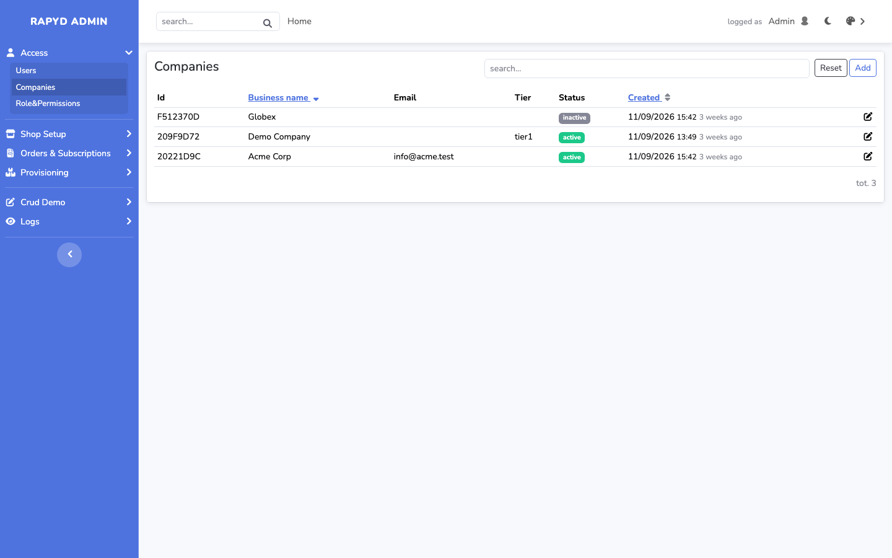

# Desk theme for rapyd-admin

The classic admin look — blue sidebar, off-white content — on the layout that ships with
[rapyd-admin](https://github.com/zofe/rapyd-admin). Light and dark mode, and on phones the sidebar becomes a drawer.



## Install

```bash
composer require zofe/theme-desk
php artisan vendor:publish --tag=laravel-assets --force
```

Then in `.env`:

```dotenv
RAPYD_THEME=desk
```

With `RAPYD_THEME_SWITCH=true` the theme is also one of the entries a visitor can pick, alongside the bundled look
and any other installed theme.

## What it is

The smallest theme possible. The layout views are the bundled ones, and the stylesheet is the stylesheet of
rapyd-admin with different colours:

```scss
@import "@rapyd/sass/rapyd";

html:not(.dark) {
    --rpd-sidebar-bg: #4e73df;
    --rpd-content-bg: #f8f9fc;
    /* … */
}
```

Everything else — components, dark mode, the mobile drawer — comes from rapyd-admin and stays in step with it.

| | light | dark |
|---|---|---|
| sidebar | `#4e73df` | `#1f2a4d` |
| topbar | `#ffffff` | the rapyd-admin default |
| content | `#f8f9fc` | the rapyd-admin default |
| borders | `#dce1ea` | `#39455c` |

## Build

```bash
npm install
npm run build
```

`vite.config.js` resolves rapyd-admin next to this package while developing (`../rapyd-admin`) and in `vendor/`
once installed. The output is `public/rapyd.css` and `public/rapyd.js`, published by the application under
`public/vendor/themes/desk`.

## Licence

MIT.
